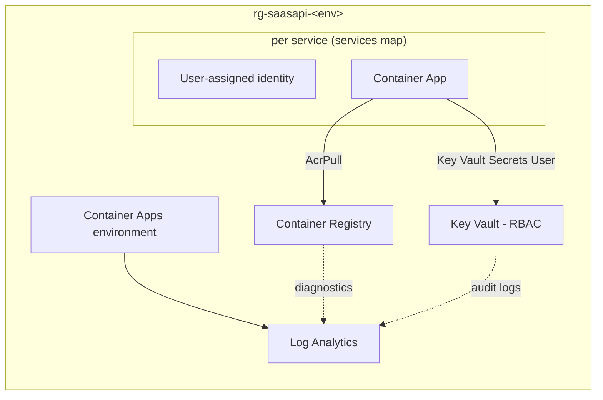
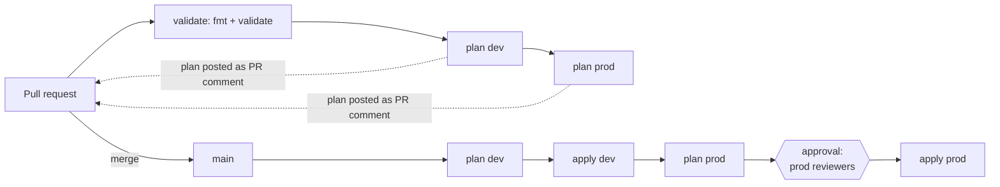

# SaaS API platform on Azure

Terraform + GitHub Actions for a containerised API with a **dev** and a **prod** environment.
No long-lived credentials, every change planned in the pull request, prod applied only after a
human approves.

| Document | For |
|---|---|
| this README | how it works and why (key decisions) |
| [docs/client-summary.md](docs/client-summary.md) | the client's CTO, half a page |
| [docs/team-setup.md](docs/team-setup.md) | day one for the two engineers, AI conventions |
| [docs/work-plan.md](docs/work-plan.md) | remaining work to production-ready, per engineer |
| [docs/pr-review.md](docs/pr-review.md) | review of the Middle engineer's pull request |
| [AI_USAGE.md](AI_USAGE.md) | how AI was used here and how to roll it out |
| [CLAUDE.md](CLAUDE.md) | rules for humans and AI assistants in this repo |

## What gets deployed (per environment)



| Need | Choice | Why |
|---|---|---|
| Compute | **Azure Container Apps** (consumption) | Runs a container API without operating a cluster; scale to zero in dev, min 1 replica in prod; revisions for safe rollouts. AKS is the upgrade path if the platform outgrows it. |
| Registry | **ACR**, admin user off | Apps pull with their managed identity (AcrPull); no registry passwords. Basic in dev, Standard in prod. |
| Secrets | **Key Vault**, RBAC mode | Values are set out of band and referenced by the app (`key_vault_secrets`); Terraform never holds secret values. Purge protection in prod. |
| Logging | **Log Analytics** | Container Apps console/system logs, plus ACR and Key Vault audit logs via diagnostic settings. 30 days dev, 90 days prod. |

Dev and prod differ only in `envs/<env>/terraform.tfvars`. Resources are named from
`Azure/avm-utl-naming`, e.g. `ca-api-dev`, `kv-saasapi-prod-xxxx`.

## Delivery flow



- **Before merge** reviewers see a plan for every environment as a PR comment (updated on each
  push) and in the run summary. `main` is protected: PR required, checks must pass.
- **After merge** dev is applied automatically. Prod is planned, and the apply job waits in the
  `prod` GitHub environment until a required reviewer approves. The reviewer sees the prod plan
  in the run, and the apply job applies **exactly that plan file**; if anything changed state in
  between, Terraform rejects it as stale.
- **Which plan to trust.** A PR's plan comment is produced by workflow code the PR author controls,
  so it's a review aid, not evidence (the read-only identity limits what such a run can do). The
  authoritative plan is the one from `main`, built from reviewed code (CODEOWNERS on
  `.github/`), shown in the run and applied as-is after approval.
- Applies per environment are serialized (`concurrency: apply-<env>`); state is locked during apply.

## Key decisions

### 1. GitHub OIDC everywhere, two identities per environment
No client secrets, storage keys or PATs exist. Each environment has:

| Identity | GitHub environment | Usable from | Azure rights |
|---|---|---|---|
| `gh-IaC2-<env>-plan` | `plan-<env>` | any branch / PR | custom *Terraform Plan* role on the env RG (`*/read` + Container App `listSecrets`, which the provider needs to refresh; writes are proven denied on every PR by the `guardrails` workflow), Blob **Reader** on its state container |
| `gh-IaC2-<env>-apply` | `<env>` | **`main` only**, prod also needs a reviewer | Contributor + RBAC Administrator on **its own resource group only**, Blob Contributor on its state container |

The federated credential subject is the GitHub environment, so a workflow edited on a PR branch
can at most get a read-only identity: it can't enter `prod`, whose branch policy only admits
`main`, and `main` only changes through reviewed PRs. Subscription-level rights are needed only by
the admin running bootstrap.

### 2. Plain GitHub Actions instead of Atlantis
Atlantis was prototyped (it worked, see [andrey-parkhomets/IaC](https://github.com/andrey-parkhomets/IaC), PRs #1–#2 and `docs/atlantis.md`), but on GitHub-hosted runners it needs
extra plumbing (an event relay, persisting its data directory between jobs) and its approval rule
can be bypassed by editing the workflow on a branch. GitHub environments give the approval gate,
audit trail and branch restriction natively, with less for the team to maintain. Atlantis becomes
attractive again as a hosted service (AKS) with many teams and repos.

### 3. One stack, environments as data
`infra/` is a single root module; an environment is a `backend.hcl` and a `terraform.tfvars`.
Dev and prod can't drift in structure, only in size. Services are a map, so a new API is one
tfvars entry, and it gets its own identity and least-privilege role assignments from the module.

### 4. Bootstrap owns trust, the pipeline owns resources
`bootstrap/` (run by an admin, rarely) creates what CI can't safely create for itself: the state
storage, the environment resource groups, the CI identities and their role assignments, the GitHub
environments with their protection rules and variables, and the branch protection of `main`. The
environment pipeline cannot widen its own permissions.

### 5. Remote state per environment, Entra ID only
One storage account, one container per environment (plus one for bootstrap). Shared keys are
disabled; access is RBAC per container. Versioning and 30-day soft delete protect against bad
writes, a delete lock protects the resource group, and an Azure Policy requires blob soft delete.
PR plans run with `-lock=false` because the plan identity can only read state.

### 6. Image tags belong to the application
Infra creates the Container App with a placeholder image and ignores later image changes. The
application's own pipeline builds, pushes to ACR and rolls out new revisions (see work plan).

### 7. No API Management (yet)
APIM solves needs this client hasn't stated: many APIs or external consumers behind one front
door, per-consumer keys and quotas, versioning, a developer portal, AI token governance. For one
API, Container Apps ingress already gives TLS, custom domains, built-in auth, IP restrictions and
revision-based rollouts. A production-grade gateway (Standard v2, needed for the Front Door →
Private Link → APIM pattern) costs ~$700/month in Poland Central, several times the rest of this
platform, and adds a second configuration surface for a two-person team. Adding it later is
non-breaking: a new platform component, services switch to internal ingress, the domain moves to
the gateway. Trigger to revisit: any of the needs above appears. Reference architectures:
[Azure-Samples/Apim-Samples](https://github.com/Azure-Samples/Apim-Samples).

### 8. Supply chain and hygiene
Actions pinned to commit SHAs (Dependabot keeps them current), provider lock files committed,
pre-commit with fmt/validate/tflint/gitleaks, CODEOWNERS on CI, bootstrap and prod.

## Adding things

| To add | Do |
|---|---|
| a service | an entry in `services` in `envs/<env>/terraform.tfvars` |
| an environment | an entry in `bootstrap/terraform.tfvars` → bootstrap apply → `scripts/backend-config.sh` → `envs/<env>/terraform.tfvars` → one job in `infra.yml` |
| a subscription per environment | set `subscription_id` per environment (the variable is already per GitHub environment) and run bootstrap for it |

## Bootstrap (admin, once)

```sh
az login                                   # Owner on the subscription
export GITHUB_TOKEN=$(gh auth token)       # repo admin
cd bootstrap
# first run only: comment out the backend block in versions.tf
terraform init && terraform apply
../scripts/backend-config.sh                # writes bootstrap/ and envs/*/backend.hcl
# uncomment the backend block, then
terraform init -migrate-state -backend-config=backend.hcl
```

### Verify the CI identities

```sh
# rights of the read-only plan role (-o json: table output can't show nested lists)
az role definition list --name "Terraform Plan (saasapi)" --query '[0].permissions' -o json
# what one identity can do, and that it has no secrets
APP=$(az ad app list --display-name gh-IaC2-prod-plan --query '[0].appId' -o tsv)
az role assignment list --assignee "$APP" --all -o table
az ad app credential list --id "$APP" -o json                       # []
az ad app federated-credential list --id "$APP" --query '[].subject' -o tsv
```

## Not in scope (yet)

Networking (VNet integration, private endpoints), custom domains and TLS, alerts and dashboards,
the application's build/deploy pipeline, policy-as-code in CI (checkov/tfsec). All are in the
[work plan](docs/work-plan.md).

Subscription and tenant IDs in this repo are identifiers, not credentials, and are committed on
purpose.
